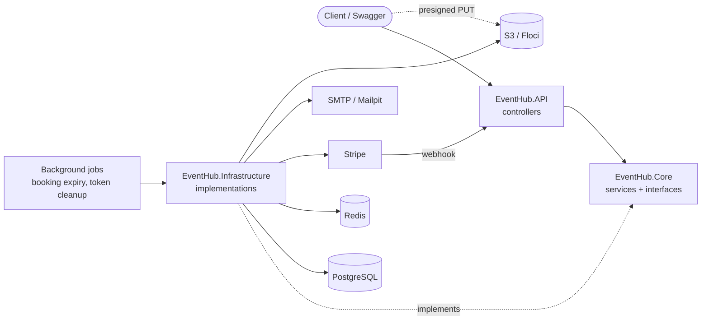
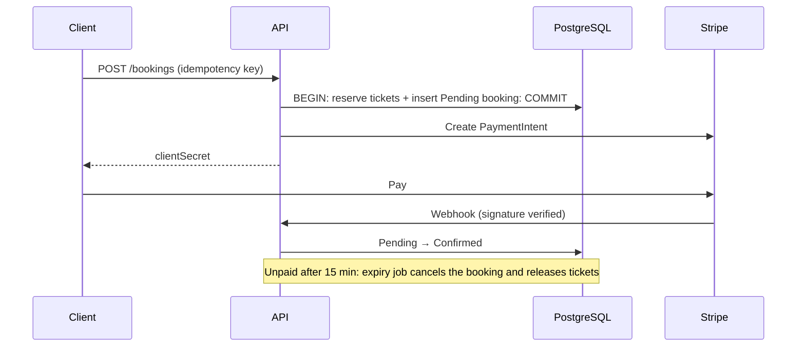

# EventHub

[](https://github.com/nguyen-duong-tien-phat/event-hub-DotNet/actions/workflows/dotnet-ci.yml)


**A ticketing and booking backend that never oversells.** When 30 people race for the last tickets, exactly the stock available is sold and everyone else gets a clean `409`. Built solo with ASP.NET Core 10, PostgreSQL, Redis and Stripe.

**Try it:** run it locally and open Swagger at `http://localhost:8080/swagger` (see [Run locally](#run-locally)).

## Highlights

- **Oversell-proof inventory.** One atomic SQL statement decides every reservation, so concurrent requests can't double-sell a ticket, with no locks in application code.
- **Real payments.** Stripe PaymentIntents, signature-verified webhooks, idempotent confirmation, and automatic refunds when a payment lands after the booking expired.
- **Safe to retry.** Per-user idempotency keys mean a double-click or network retry returns the original booking instead of creating a second one.
- **Production-style auth.** Short-lived JWTs, rotating refresh tokens with reuse detection, rate-limited login, and email-code password reset.
- **Tamper-proof QR check-in.** HMAC-signed ticket codes, each admitted exactly once at the door.
- **Images that skip the server.** Organizers upload posters straight to S3 with a short-lived presigned URL, so image bytes never pass through the API. Only URLs the API issued are accepted.

## Tech stack

| Layer | Choice | Why |
|---|---|---|
| Backend | ASP.NET Core 10 Web API | Thin controllers; all rules live in a framework-free Core project |
| Database | PostgreSQL 16 + EF Core (Npgsql) | The atomic conditional `UPDATE` gives the oversell guarantee |
| Cache / limits | Redis 7 | Cache-aside event list and a token-bucket rate limiter |
| Payments | Stripe (PaymentIntents + webhooks) | Async confirmation, no DB transaction held across a network call |
| Auth | JWT + DB-backed refresh tokens | Rotation and reuse detection |
| Files | S3 via presigned URLs (Floci locally) | Browsers upload directly; the API only signs and validates |
| Testing | xUnit, Moq, k6 | Services unit-tested with mocked repositories; k6 for concurrency |
| Infra | Docker Compose, GitHub Actions | One command for the full stack; CI builds and tests every push |

## Who can do what

| Role | Can |
|---|---|
| **Attendee** | Browse events, book and pay, see their own bookings and ticket codes, save events |
| **Organizer** | Everything on their own events: create, edit and delete them (not once booked), upload posters, manage ticket types (a ticket that has sold can't be deleted), see bookings with the buyer's name and email, check tickets in |
| **Admin** | The same on any event, plus list users and set their roles (an admin cannot lower their own) |

## Architecture



Dependencies point inward: `API → Core ← Infrastructure`. Core defines the interfaces (`IRepository<>`, `IUnitOfWork`, `IPaymentService`, `ICacheService`, `IRateLimiter`, `IEmailSender`) and Infrastructure implements them, so every business rule is unit-tested with Moq and no database.

### Booking and payment flow



## Technical challenges and solutions

### 1. Selling exactly N tickets under concurrent load

**Problem:** with N tickets left and M concurrent buyers, exactly N must succeed.
**Solution:** reservation is a single statement whose rows-affected count is the verdict:

```sql
UPDATE "Tickets"
SET "RemainingQuantity" = "RemainingQuantity" - @n
WHERE "Id" = @id AND "RemainingQuantity" >= @n
```

Postgres serializes writes to the row, so no read-then-write race exists. Version-token optimistic concurrency would reject buyers even when stock remained, and `SELECT ... FOR UPDATE` holds a row lock for the whole transaction. The reserve and the booking insert share one transaction, so a crash can't orphan a reservation.

### 2. Taking payments without holding a transaction open

**Problem:** calling Stripe inside a DB transaction ties up connections and locks on a network call.
**Solution:** commit the reservation first, then create the PaymentIntent. If Stripe fails, the booking is cancelled and tickets are released. Confirmation comes from a signature-verified webhook or a client call, and both are idempotent. A `(UserId, IdempotencyKey)` unique index makes retries and races return the original booking, and a payment that succeeds after cancellation is refunded.

### 3. Tickets that can't be forged or reused

**Problem:** a QR code anyone can guess or screenshot-replay is worthless.
**Solution:** each admitted person gets an HMAC-signed code over `(bookingId, n)`. Check-in verifies the signature and records each `(booking, number)` once. The signing secret is deliberately separate from the JWT key, so a leaked JWT key can't mint tickets.

## Results

- **160+ automated tests** (xUnit + Moq) covering booking, payments, check-in, refresh tokens, password reset and cleanup jobs. CI builds and tests on every push.
- **Concurrency verified with k6:** 30 simultaneous booking requests against a ticket with known stock. Successes matched the remaining stock exactly, the rest received `409 Conflict`, and nothing oversold. See [`load-test.js`](load-test.js).
- **What I learned:** pushing correctness into one atomic database statement is simpler and faster than coordinating it in application code, and keeping network calls out of transactions makes failure handling tractable.

## Run locally

Requires Docker. Copy [`.env.example`](.env.example) to `.env` in the repo root and fill in `Jwt__Key`, `Tickets__Secret` and the two Stripe keys. The compose file already runs a Floci container (a local AWS emulator) for event images and points the API at it; do the one-time bucket setup in [Event images and CORS](#event-images-and-cors) after the first start. Then:

```bash
git clone git@github.com:nguyen-duong-tien-phat/event-hub-DotNet.git
cd event-hub-DotNet
docker compose up --build        # API :8080, Swagger :8080/swagger, Mailpit inbox :8025
dotnet test                      # unit tests, no infrastructure needed
k6 run load-test.js              # concurrency test (set a JWT and ticketId at the top first)
```

For the Stripe webhook locally, run `stripe listen --forward-to localhost:8080/webhooks/stripe` and use the printed `whsec_...` as `Stripe__WebhookSecret`.

### Event images and CORS

Poster images go from the browser straight to S3 (a presigned `PUT`), so two CORS rules are needed:

- **The API** lets the web dashboard call it. Set `Cors__AllowedOrigins` (comma separated; default `http://localhost:5173`).
- **The bucket** must allow the dashboard's origin to `PUT` the file. Locally the bucket lives in Floci:

```bash
eval "$(floci aws env -o text)"          # point the aws CLI at Floci, not real AWS
aws s3 mb s3://eventhub-images
aws s3api put-bucket-cors --bucket eventhub-images --cors-configuration \
  '{"CORSRules":[{"AllowedOrigins":["http://localhost:5173"],"AllowedMethods":["PUT","GET"],"AllowedHeaders":["Content-Type"]}]}'
```

The Floci in `docker-compose.yml` keeps its data in the `floci-data` volume, so the bucket, its CORS rule and the images survive restarts (`docker compose down -v` deletes them, along with the database). Don't also run `floci aws start`: both want port 4566.

In production list only the real dashboard origin in both places, never `*`.

**Reading the images (mobile and web).** The Flutter app and the dashboard show a poster with a plain `GET` on `imageUrl`, with no token. On real AWS the bucket must therefore allow public reads, for the image folders only:

```bash
aws s3api put-bucket-policy --bucket eventhub-images --policy \
  '{"Version":"2012-10-17","Statement":[{"Effect":"Allow","Principal":"*","Action":"s3:GetObject","Resource":["arn:aws:s3:::eventhub-images/events/images/*","arn:aws:s3:::eventhub-images/users/avatars/*"]}]}'
```

Floci accepts this command but does not enforce read policies (every object is readable locally), so it only matters on real AWS. The mobile app needs no CORS: that rule is only for browsers.

**The host in `S3__PublicBaseUrl` is saved into every event's `imageUrl`.** The default `localhost.floci.io` points at the device itself on a phone or an Android emulator, so the poster will not load there. Before uploading images from a device, set `S3__ServiceUrl` and `S3__PublicBaseUrl` to an address the device can reach (your computer's LAN IP, or `10.0.2.2` for the Android emulator). Changing it later does not rewrite existing events.

## Roadmap

- Webhook and payment-flow integration tests
- Structured logging throughout
- Email notification on booking confirmation
